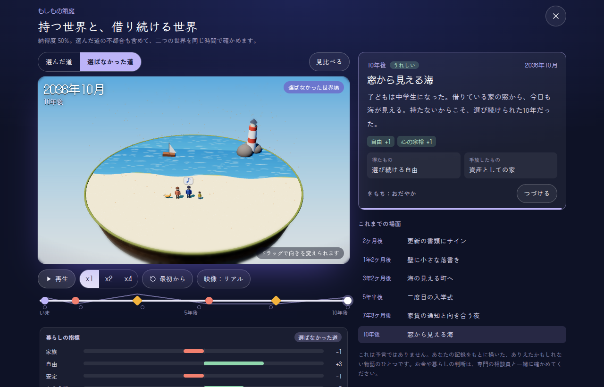
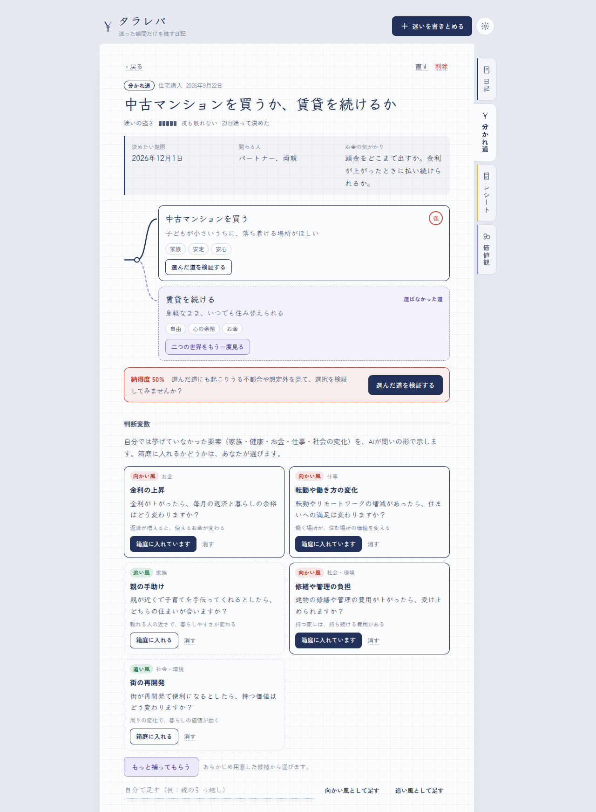
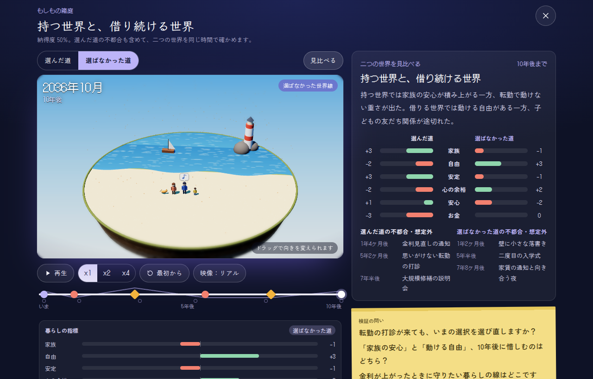
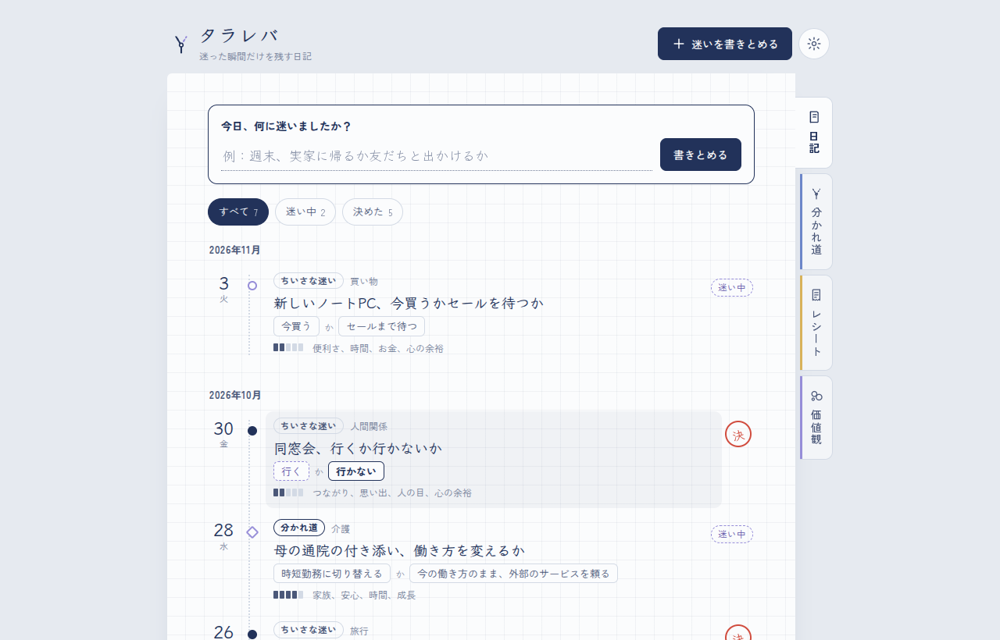
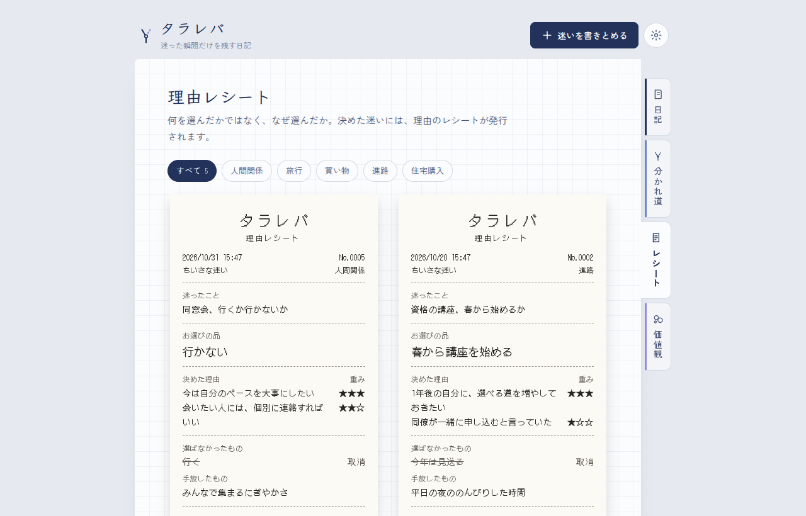
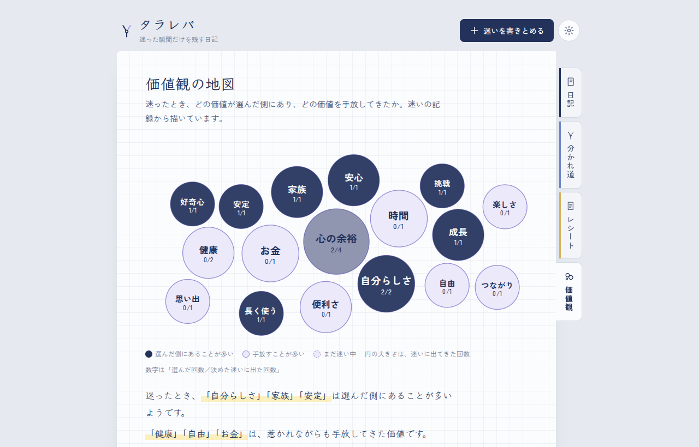
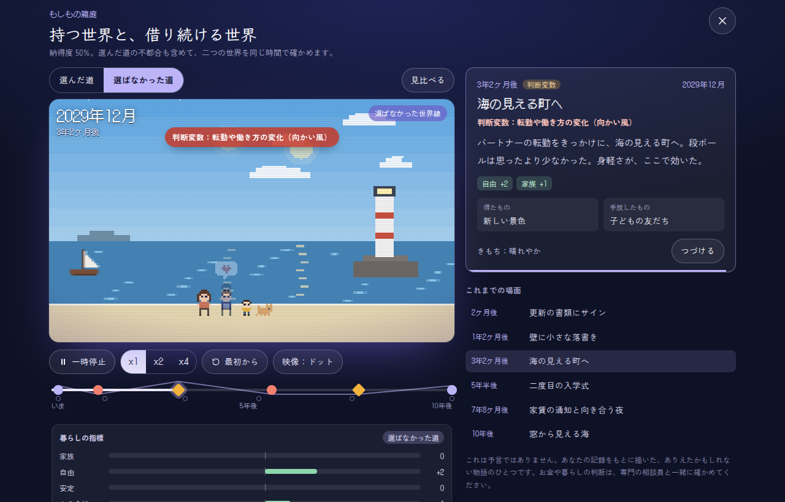
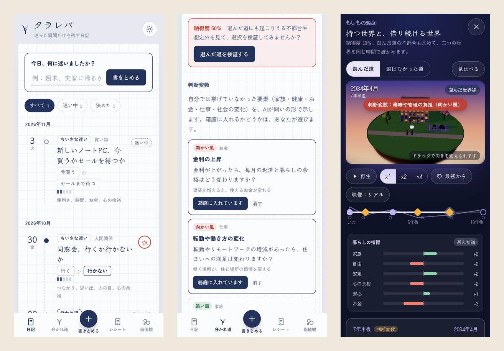

# タラレバ

**迷った瞬間だけを残す日記。**
結果ではなく、迷いを残します。選択肢と、揺れた気持ちと、決めた理由を書きとめていくと、あなたが手放さないもの（価値観）が見えてきます。



## v2 で変わったこと

ユーザーテストの声をもとに、「もしもの箱庭」を作り直しました。

| ユーザーテストの声 | v2 での対応 |
| --- | --- |
| 選んだ理由を振り返る場面があり、自分の判断を再認識できて安心できた | 理由レシートと、選んだ道を振り返る場面はそのまま残しました。 |
| 納得度は50%にとどまった。後悔や想定外も示されれば、判断により責任を持てる | **改善①「選択を肯定する」から「選択を検証する」へ。** 選んだ道と選ばなかった道を、同じ時間軸で描きます。納得度が低いほど、選んだ道の不都合・後悔・想定外を厚く描きます。見比べたあとに納得度を付け直し、「検証の記録」に残せます。 |
| 自分が挙げた要素だけでなく、気づいていなかった良し悪しや外部環境の変化まで示されると、判断の解像度が高まる | **改善② 本人が気づいていない「判断変数」をAIが補います。** 家族・健康・お金（金利や物価）・仕事・社会の変化を、追い風と向かい風の「問い」として示します。採用するかどうかは本人が選ぶので、最終的な主導権は人に残ります。 |

映像も、ドット絵から**立体のミニチュア世界**に変えました。浮かぶ島の上で、季節・昼夜・天気・人の暮らしが早送りで進みます。判断変数を入れ替えて描き直すと、条件を動かして結果を確かめられます（マイクロワールド）。

## できること

- **迷いの日記**：買い物・旅行・進路など、迷った瞬間を選択肢と気持ちごと残します。
- **分かれ道ノート**：進学・結婚・住宅購入・介護など人生の転換点を、期限・関わる人・お金の気がかり・迷いのログと一緒にまとめます。
- **問い返しの付箋**：AIは助言やおすすめをせず、考えるための問いだけを1つずつ返します。
- **判断変数**：自分では挙げていなかった要素を、AIが問いの形で示します。箱庭に入れるかどうかは、自分で選びます。自分で足すこともできます。
- **もしもの箱庭（二つの世界線）**：選んだ道と選ばなかった道の3年後、または10年後までを、立体のミニチュア世界で早送りします。再生中に世界線を切り替えると、同じ時期のもう一つの世界へ移れます。ドラッグで向きを変えられます。
  - 判断変数は、どちらかの世界で出来事として起こります。
  - 場面ごとに「暮らしの指標」（家族・自由・お金など、その迷いの価値）がどう動いたかを表示します。
- **見比べと検証**：二つの世界の暮らしの指標、不都合・想定外の場面、検証の問いを並べて見比べます。そのあとの納得度を「検証の記録」に残します。
- **理由レシート**：何を選んだかではなく、なぜ選んだかを、★の重み付きでレシートに残します。選ばなかった方は「取消」と印字されます。判断変数と検証の回数も印字されます。
- **価値観の地図**：迷ったときに選んだ側・手放した側にあった価値を集計し、円の大きさと濃さで描きます。
- **ライフプラン相談シート**：銀行・保険・FP・自治体などの相談に持っていくまとめを作ります。自動で送信はしません。

| 分かれ道ノート（判断変数と検証の案内） | 二つの世界を見比べる |
| --- | --- |
|  |  |
| **日記** | **理由レシート** |
|  |  |
| **価値観の地図** | **ドット表示（立体が使えない環境）** |
|  |  |



## すぐに試す

`index.html` をブラウザで開くだけで動きます。インストールやビルドは要りません。

最初の画面で「サンプルで試す」を押すと、7件のサンプルが入ります。住宅購入のサンプルは納得度50%で、判断変数と二つの世界線の物語が用意してあります。AIなしでも、すぐに「選んだ道を検証する」を試せます。

ファイルを直接開くと、一部の機能（コピーなど）がブラウザに制限されることがあります。そのときは、このフォルダで次のコマンドを実行し、`http://localhost:8000` を開いてください。

```bash
python3 -m http.server 8000
```

## GitHub で公開する（誰でも見られるようにする）

### 1. 公開リポジトリを作って置く

1. GitHub で新しいリポジトリを作ります（例：`tarareba`）。公開範囲は **Public** を選びます。
2. 次のどちらかの方法で、このフォルダの中身を置きます。

コマンドで置く場合：

```bash
cd tarareba
git init
git add .
git commit -m "タラレバ v2"
git branch -M main
git remote add origin https://github.com/<ユーザー名>/tarareba.git
git push -u origin main
```

ブラウザだけで置く場合：リポジトリの「uploading an existing file」を開き、このフォルダの**中身**をすべてドラッグ＆ドロップして「Commit changes」を押します。

### 2. GitHub Pages を設定する

1. リポジトリの **Settings → Pages** を開きます。
2. **Build and deployment** の Source を「Deploy from a branch」、Branch を「main」と「/ (root)」にして Save を押します。
3. 数分後、`https://<ユーザー名>.github.io/tarareba/` で誰でも開けます。

公開する前に、次のことを確認してください。

- `LICENSE` の `YOUR NAME` を自分の名前に書き換えたか。
- APIキーなどの秘密の情報を、ファイルに書き込んでいないか（このアプリはキーをブラウザの中にだけ保存します）。

## AIを使う（任意）

AIがなくても、すべての機能が動きます。そのときは、あらかじめ用意した問い・判断変数の候補と、記録から組み立てる簡易版の物語を使います。

自分の Anthropic APIキーを入れると、問い返し・判断変数・箱庭の物語・相談で聞きたいことを AI が考えます。

1. [Claude Console](https://platform.claude.com) で APIキーを発行します。
2. アプリ右上の設定を開き、「Anthropic APIキー」に貼り付けて「このキーでAIを使う」を押します。

| 用途 | 既定のモデル |
| --- | --- |
| 箱庭の物語（二つの世界線）・相談の質問 | `claude-sonnet-5-5` |
| 問い返し・判断変数 | `claude-haiku-5-5` |

モデル名は、設定の「使うモデル」で変えられます。APIは `anthropic-version: 2026-10-21` で、ストリーミングで呼び出します。箱庭の物語は1行1場面の形で届くので、描けた場面から順に再生が始まります。

### APIキーの扱い（必ずお読みください）

- キーはブラウザの中にだけ保存されます（「このブラウザに記憶する」がオンなら localStorage、オフなら sessionStorage）。送り先は `https://api.anthropic.com` だけで、このアプリにサーバーはありません。
- ブラウザから直接APIを呼ぶため、`anthropic-dangerous-direct-browser-access` ヘッダーを使っています。キーをソースコードに書き込んだり、公開サイトに埋め込んだりしないでください。
- キーは、自分で公開したコピーか、手元で開いたコピーにだけ入れてください。他人が公開したコピーは、コードを書き換えてキーを盗むこともできるためです。
- 共有のパソコンでは「このブラウザに記憶する」をオフにしてください。
- 利用料金は、あなたのAPIアカウントにかかります。
- 参考：[API key best practices](https://support.anthropic.com/en/articles/9767949-api-key-best-practices-keeping-your-keys-safe-and-secure)

AIを使うと、その迷いの記録の内容（選択肢・理由・迷いのログ・採用した判断変数など）がAnthropicに送られます。

## データについて

- 記録はブラウザの localStorage に保存されます。サーバーには送りません。GitHub Pages で公開しても、記録は見た人それぞれのブラウザの中にだけ残ります。
- ブラウザのデータを消すと、記録も消えます。設定の「すべての記録を書き出す」でJSONファイルに保存し、「記録を読み込む」で戻せます。別の端末へ移すときにも使えます。v1 で書き出した記録もそのまま読み込めます。
- claude.ai のアーティファクトとして開いた場合は、claude.ai のあなた専用の保存領域と、claude.ai のAIを自動で使います（APIキーは要りません）。

## しくみ

### 二つの世界線と検証

1. 箱庭を開くと、「選んだ道」と「選ばなかった道」（迷い中なら二つの選択肢）の物語を、AIが1回の呼び出しでまとめて描きます。
2. 納得度に応じて、選んだ道に入れる後悔・不都合・想定外の場面の数を変えます（40%以下は3つ以上、60%以下は2つ以上、それ以外は1つ以上）。
3. 採用した判断変数は、少なくとも一方の世界で出来事として起こします。本人が挙げていない追い風も1つ以上入れます。
4. 各場面は、暮らしの指標がどう動いたか（−2〜+2）を持ちます。見比べ画面で、二つの世界の合計を並べます。
5. 見比べたあとの納得度とメモを「検証の記録」に残します。ノートには納得度の変化（例：50% → 65%）が残ります。

AIの出力に壊れた行があっても、その行を捨てて次の行から読み直します。足りない場面や結末は、記録から組み立てた簡易版で補います。

### 立体のミニチュア世界

[three.js](https://threejs.org/)（r128）を cdnjs から読み込み、浮かぶ島のジオラマを描きます。

- 場所は、家・マンション・街・田畑・学校・オフィス・駅・カフェ・海辺の9つと、分かれ道です。
- 季節で木の色や雪が変わり、昼夜で空と光が変わります。雨・雪・桜・落ち葉・蛍も降ります。
- 人・車・電車・船が動き、夜には窓や街灯が灯ります。
- 画面の上下をぼかして、ミニチュア写真のような見え方にしています。

WebGL が使えない端末や、three.js を読み込めないときは、v1 のドット表示に自動で切り替わります。箱庭の「映像：リアル／ドット」ボタンでも切り替えられます。「視差効果を減らす」の設定がオンのときは、動きを抑えます。

## ファイル構成

```text
tarareba/
├── index.html       画面の骨組み（three.js を cdnjs から読み込む）
├── favicon.svg
├── CHANGELOG.md     変更履歴
├── README.md
├── LICENSE
├── style.css        見た目（色・文字・レイアウト）
├── util.js          共通関数
├── data.js          定数・サンプル・AI関連データ
├── platform.js      データ保存・AI・ファイル入出力
├── views.js         各画面の表示
├── sheets.js        書きとめ・設定・入力
├── world3d.js       立体のミニチュア世界
├── hakoniwa.js      もしもの箱庭・再生・比較
├── main.js          アプリの起動
└── *.png            README用スクリーンショット
```

ビルドは不要です。外部から読み込むのは、three.js（cdnjs）と Google Fonts だけです。

## カスタマイズ

| 変えたいもの | 場所 |
| --- | --- |
| 価値の候補（安心・自由など） | `data.js` の `VALUES` |
| テーマ（買い物・住宅購入など） | `data.js` の `KINDS` |
| AIへの指示文 | `data.js` の `questionPrompt`・`variablesPrompt`・`worldPrompt`・`consultPrompt`・`valuesPrompt` |
| 納得度と、選んだ道に入れる不都合の数 | `data.js` の `convictionNeed` |
| AIなしのときの判断変数の候補 | `data.js` の `VAR_BANK`・`VAR_BANK_CAT` |
| AIなしのときの問い | `data.js` の `GENERIC_Q`・`CAT_Q` |
| 相談で聞きたいことの例 | `data.js` の `CONSULT_Q` |
| 立体の箱庭の場所 | `world3d.js` の `bHome`・`bSea` などの関数 |
| ドット表示の箱庭の場所 | `hakoniwa.js` の `pHome` などの関数 |
| 色 | `style.css` の `:root` |

## 動作環境

最新版の Chrome・Edge・Safari・Firefox で動きます。スマホにも対応しています。立体の箱庭には WebGL が必要です（使えないときはドット表示になります）。

## 注意

- 箱庭の物語は予言ではありません。記録をもとに描いた「ありえたかもしれない物語」のひとつです。
- 判断変数と検証の問いは、考えるための材料です。どちらを選ぶべきかは示しません。
- 相談シートは、相談の場で話すことをまとめるためのものです。お金や保険についての助言ではありません。判断は、専門の相談員と一緒に確かめてください。

## ライセンス

[MIT License](LICENSE)。公開する前に、`LICENSE` の `YOUR NAME` を自分の名前に書き換えてください。

- [three.js](https://github.com/mrdoob/three.js)：MIT License（© three.js authors）。cdnjs から読み込みます。
- フォント：[Klee One](https://fonts.google.com/specimen/Klee+One)、[Zen Kaku Gothic New](https://fonts.google.com/specimen/Zen+Kaku+Gothic+New)、[DotGothic16](https://fonts.google.com/specimen/DotGothic16)（いずれも SIL Open Font License。Google Fonts から読み込みます）
